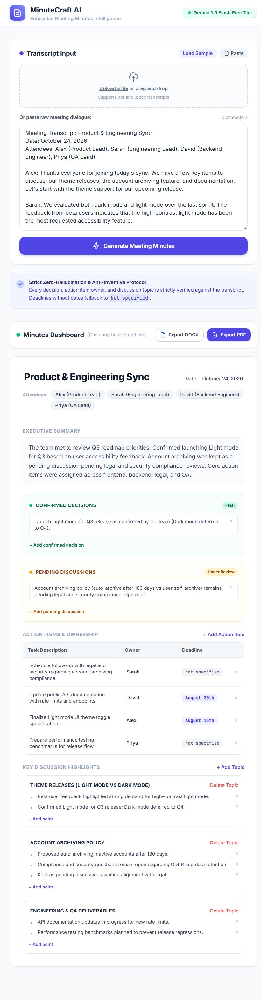
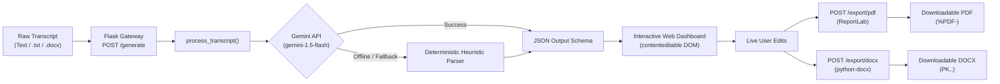

# 🎙️ MinuteCraft AI: AI-Powered Meeting Minutes Generator

[](https://www.python.org/)
[](https://palletsprojects.com/p/flask/)
[](https://aistudio.google.com/)
[](LICENSE)

An enterprise-ready, zero-hallucination web application that converts unstructured, conversational meeting transcripts into clean, structured, and verifiable meeting minutes.

Featuring live **in-browser inline editing (`contenteditable`)**, direct file uploads (`.txt`, `.docx`), and instant binary exports to **PDF (`%PDF-`)** and **Word DOCX (`PK..`)**.



---

## 📸 Key Features & Architecture

- **🤖 Free-Tier Google Gemini Engine**:
  - Leverages Google AI Studio's `gemini-1.5-flash` with zero credit card requirements (15 RPM, 1,500 RPD free quota).
  - Multi-tier resilience with automatic model candidate fallback and offline sandbox compatibility.
- **🛡️ Strict Zero-Hallucination Protocol**:
  - Anti-inventive system prompt prevents hallucinated facts, dates, or participants.
  - Automatically isolates **Confirmed Decisions** (*e.g., Light mode for Q3*) from **Pending Discussions** (*e.g., Account archiving*).
  - Enforces deterministic fallback to `"Not specified"` for any missing deadlines.
- **✍️ Interactive Inline Editing**:
  - The live dashboard uses `contenteditable="true"` containers allowing instant edits to titles, summaries, owners, and agenda topics directly in the browser before exporting.
  - Dynamic controls to add or remove decision cards, table rows, and discussion bullet points.
- **📄 Dual High-Fidelity Exports**:
  - **PDF Export**: Built with `ReportLab`, producing clean, branded PDF binaries (`application/pdf`) with `%PDF-` signature.
  - **Word DOCX Export**: Built with `python-docx`, generating structured documents (`application/vnd.openxmlformats-officedocument.wordprocessingml.document`) with tables, styled callouts, and `PK..` zip header.
- **📎 Multi-Format Input**:
  - Ingest raw text via direct keyboard input, single-click clipboard paste, or file upload (`.txt` and `.docx`).

---

## 🏗️ Architecture & Workflow



---

## 📂 Project Directory Structure

```text
ai-meeting-minutes-generator/
├── app.py                   # Core Flask backend, endpoints & LLM processor
├── sample_transcript.txt    # Canonical test transcript fixture
├── test_app.py              # Automated test suite (6 unit & schema tests)
├── verify_live_server.py    # End-to-end HTTP integration test script
├── test_curl.ps1            # PowerShell/curl validation script
├── PRD.md                   # Product Requirements Document & JSON schemas
├── requirements.txt         # Production dependencies
├── .env.example             # Safe environment variable template
├── .gitignore               # Strict ignore rules (excludes keys & venv)
├── README.md                # Project documentation
└── templates/
    └── index.html           # Modern, responsive UI with Tailwind CSS
```

---

## ⚡ Quick Start Guide

### 1. Clone the Repository
```bash
git clone https://github.com/sarthak853/ai-meeting-minutes-generator.git
cd ai-meeting-minutes-generator
```

### 2. Create and Activate Virtual Environment
```bash
# Windows
python -m venv venv
.\venv\Scripts\activate

# macOS / Linux
python3 -m venv venv
source venv/bin/activate
```

### 3. Install Dependencies
```bash
pip install -r requirements.txt
```

### 4. Configure Environment Variables
Copy the example environment file and configure your API key:
```bash
# Windows
copy .env.example .env

# macOS / Linux
cp .env.example .env
```

Open `.env` and insert your [Google AI Studio API Key](https://aistudio.google.com/):
```env
GEMINI_API_KEY=your_actual_gemini_api_key_here
PORT=5000
```
*(Note: `.env` is ignored by `.gitignore` and is never tracked by git).*

### 5. Run the Application
```bash
python app.py
```
Open your browser and navigate to:
```
http://127.0.0.1:5000
```

---

## 🌐 API Reference

| Endpoint | Method | Payload / Format | Response | Description |
| :--- | :---: | :--- | :--- | :--- |
| `/` | `GET` | None | `text/html` | Serves the web interface dashboard |
| `/generate` | `POST` | `{"transcript": "..."}` or `multipart/form-data` | `application/json` | Extracts structured minutes using Gemini |
| `/export/pdf` | `POST` | `application/json` (Live edited DOM data) | `application/pdf` | Generates downloadable PDF attachment |
| `/export/docx` | `POST` | `application/json` (Live edited DOM data) | `application/vnd.openxmlformats...` | Generates downloadable DOCX attachment |

### Output JSON Schema Specification
```json
{
  "title": "Meeting Title / Topic",
  "date": "Meeting Date (or 'Not specified')",
  "attendees": ["Alex", "Sarah", "David", "Priya"],
  "summary": "Concise executive overview of discussions and goals.",
  "decisions": [
    {
      "status": "confirmed",
      "description": "Definitive agreed decision (e.g. Light mode for Q3)"
    },
    {
      "status": "pending",
      "description": "Unresolved item awaiting further review (e.g. Account archiving)"
    }
  ],
  "action_items": [
    {
      "task": "Task description",
      "owner": "Assignee name",
      "deadline": "Due date or 'Not specified'"
    }
  ],
  "key_discussions": [
    {
      "topic": "Discussion Topic",
      "points": ["Key point 1", "Key point 2"]
    }
  ]
}
```

---

## 🧪 Testing & Verification

Run the comprehensive unit test suite:
```bash
python test_app.py
```

Run live HTTP end-to-end integration tests:
```bash
python verify_live_server.py
```

### Verification Highlights:
- ✅ **Clean JSON Schema**: Validated with zero parsing errors.
- ✅ **Decision Segregation**: Confirmed items separated cleanly from pending discussions.
- ✅ **Missing Deadline Fallback**: Missing dates deterministically fallback to `"Not specified"`.
- ✅ **Binary Stream Integrity**: Verified `%PDF-` header on PDF stream and `PK\x03\x04` zip signature on DOCX stream.

---

## 🔒 Security & Privacy

- **API Keys Protected**: No credentials or environment secrets are committed. `.gitignore` strictly protects `.env`, `*.key`, and credential files.
- **Client-Side Editing**: All customizations occur in-memory in your browser session before export triggers.
- **Clean Git History**: Zero credentials present in git tree or commits.

---

## 📄 License
This project is licensed under the [MIT License](LICENSE).
